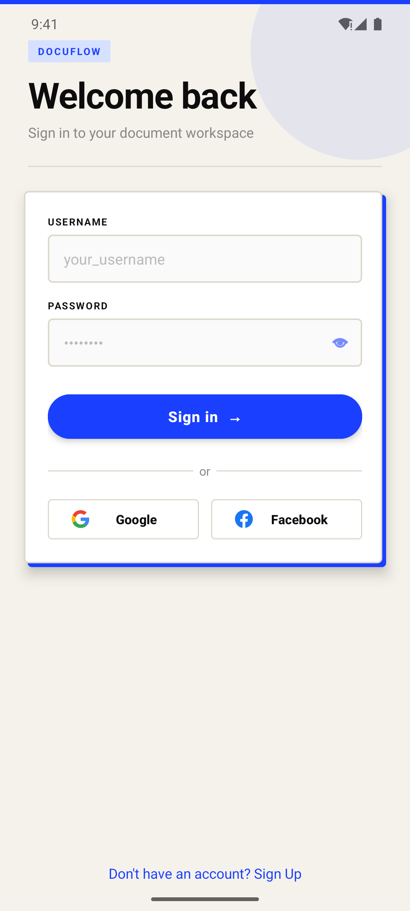
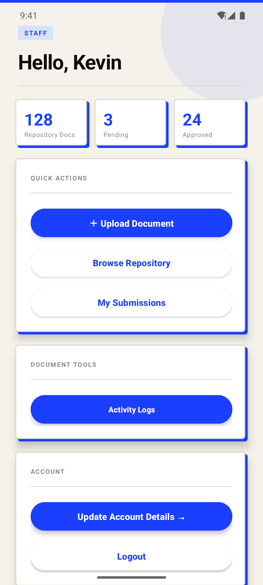
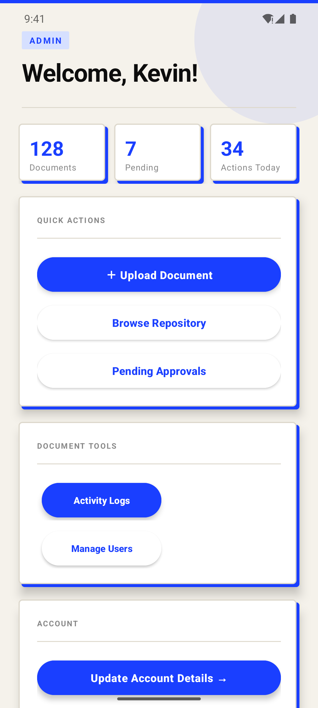
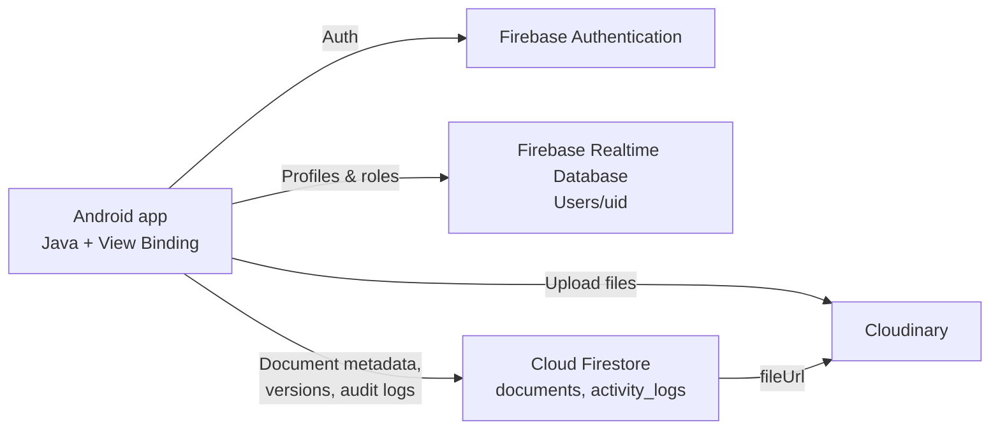

# DocuFlow

**A role-based document management app for Android.**

DocuFlow gives an organization a single place to upload, review, approve, search, and version documents. Staff submit files, admins approve or reject them, and key actions are written to an audit log. The app is built with Java, Firebase, and Cloudinary.

> This project was originally an academic Android app named `LoginSignup`. It has been cleaned up, rebranded, and prepared as a portfolio project. The internal package name (`com.example.loginsignup`) is kept so the existing Firebase Android configuration continues to work.

## App preview

<table>
  <tr>
    <td align="center" width="33%">
      <br />
      <sub><b>Sign in</b> — username, Google, and Facebook</sub>
    </td>
    <td align="center" width="33%">
      <br />
      <sub><b>Staff dashboard</b> — personal document stats and actions</sub>
    </td>
    <td align="center" width="33%">
      <br />
      <sub><b>Admin dashboard</b> — approvals, users, and audit tools</sub>
    </td>
  </tr>
</table>

Screenshots were captured from the debug build on a Pixel 6 emulator (Android 15).

---

## Why it exists

Small teams often pass documents around through chat and email. That makes it hard to know which version is current, who approved a file, or who changed something. DocuFlow models a simple document lifecycle instead:

```
Staff upload  →  Admin reviews  →  Approved repository
                       ↓
                  Rejected archive  →  Restore or delete
```

---

## Features

### Authentication
- Email + password sign in
- Username-based login that resolves to the account email
- Google Sign-In (One Tap / Credential Manager flow)
- Facebook Login
- Profile completion flow after social sign-up
- Password strength meter with live requirements
- Username uniqueness checks

### Role-based dashboards
- **Staff**: personal stats, upload document, browse approved repository, view own submissions
- **Admin**: repository stats, pending approvals, manage users, activity logs, upload document

### Document workflow
- Upload PDFs, images, and Word documents
- Files are stored on Cloudinary; metadata lives in Firestore
- Admin approval, rejection, restore, and permanent delete
- Rejected-document archive
- Instant filename search over approved documents
- In-app document preview using Chrome Custom Tabs
- Replace a document while preserving the previous version
- Version history with timestamp and uploader

### Administration
- Promote staff to admin and demote admins
- Deactivate user accounts
- Audit log of uploads, replacements, deletions, logins, and other actions
- Original filenames are preserved on upload

### UX
- Material 3 components
- Custom warm off-white / electric-blue visual language
- Empty states and loading indicators
- Alternative `dimens.xml` values for landscape, tablet, and large-screen widths
- Custom adaptive launcher icon

---

## Tech stack

| Layer | Technology |
|---|---|
| Language | Java 11 |
| Platform | Android (min SDK 24, target/compile SDK 36) |
| UI | XML layouts, View Binding, Material 3, ConstraintLayout, RecyclerView |
| Auth | Firebase Authentication (email/password, Google, Facebook) |
| User profiles | Firebase Realtime Database |
| Documents & audit data | Cloud Firestore |
| File storage | Cloudinary Android SDK |
| Image loading | Glide |
| Social SDKs | Google Play Services Auth, Facebook Login SDK |
| Build | Gradle 8.13, Android Gradle Plugin 8.12.3 |

---

## Architecture



### Data model

**Realtime Database — `Users/{uid}`**
```json
{
  "username": "kevin",
  "firstName": "Kevin",
  "lastName": "Masangya",
  "email": "kevin@example.com",
  "age": 21,
  "address": "…",
  "birthdate": "01/01/2005",
  "role": "staff",
  "profileCompleted": true
}
```

**Firestore — `documents/{documentId}`**
```json
{
  "fileName": "project-proposal.pdf",
  "fileUrl": "https://res.cloudinary.com/…",
  "uploadedBy": "firebase-uid",
  "status": "pending",
  "timestamp": 1770000000000
}
```

**Firestore — `documents/{documentId}/versions/{versionId}`**
```json
{
  "fileUrl": "https://res.cloudinary.com/…",
  "timestamp": 1770000000000,
  "uploadedBy": "firebase-uid"
}
```

**Firestore — `activity_logs/{logId}`**
```json
{
  "uid": "firebase-uid",
  "action": "UPLOAD_DOCUMENT",
  "documentId": "N/A",
  "fileName": "project-proposal.pdf",
  "timestamp": 1770000000000
}
```

---

## Screens

| Screen | What it does |
|---|---|
| Login | Username/password, Google, Facebook |
| Sign up | Account creation with validation and profile fields |
| Complete profile | Collects details for social sign-ups |
| Admin dashboard | Counts, quick actions, document tools, account controls |
| Staff dashboard | Personal document stats and submissions |
| Browse repository | Approved documents, search, preview, replace, history |
| Pending approvals | Approve/reject queue and rejected-document archive |
| My submissions | View, rename, replace, delete own uploads |
| Version history | Previous file versions with uploader and date |
| Activity logs | Audit trail of repository actions |
| Manage users | Role changes and account deactivation |

---

## Project structure

```text
app/src/main/java/com/example/loginsignup/
├── LoginActivity.java            # Credential, Google, and Facebook auth
├── SignupActivity.java           # Registration + validation
├── UpdateProfileActivity.java    # Profile completion / editing
├── home_admin.java               # Admin dashboard
├── home_staff.java               # Staff dashboard
├── BrowseRepositoryActivity.java # Approved document repository
├── PendingApproval.java          # Approval queue + rejected archive
├── userSubmissions.java          # Staff-owned uploads
├── VersionHistoryActivity.java   # Document version timeline
├── ActivityLogsActivity.java     # Audit log viewer
├── Browse_User.java              # Admin user management
└── … adapters, models, and helpers
```

---

## Getting started

### Requirements
- Android Studio (or a standalone Android SDK)
- JDK 17
- Android SDK 36
- A Firebase project and a Cloudinary account if you are using your own backend

### Run locally

```bash
git clone https://github.com/kevin-masangya/docuflow-android.git
cd docuflow-android
```

Open the project in Android Studio, let Gradle sync, then run the `app` configuration on an emulator or device (Android 7.0+).

From the command line:

```bash
# Windows
gradlew.bat assembleDebug

# macOS / Linux
./gradlew assembleDebug
```

The debug APK is written to `app/build/outputs/apk/debug/app-debug.apk`.

### Backend configuration

The repository includes the original demo `app/google-services.json` so the project builds out of the box. To use your own backend:

1. Create a Firebase project and add an Android app with package `com.example.loginsignup`.
2. Replace `app/google-services.json`.
3. Enable **Authentication** providers: Email/Password, Google, Facebook.
4. Create a Realtime Database and a Firestore database.
5. Replace the Cloudinary cloud name and unsigned upload preset in `home_admin.java`, `home_staff.java`, `BrowseRepositoryActivity.java`, and `userSubmissions.java`.
6. Add Firestore indexes if prompted by the console (documents filtered by `status` / `uploadedBy` and ordered by `timestamp`).

---

## Security notes

This is a portfolio/demo build and it keeps the original demo credentials so the app remains runnable:

- Firebase client configuration (`google-services.json`) is not a server secret, but the demo project's rules and data are not intended for production.
- The Cloudinary upload preset is an **unsigned** preset embedded in the client. For a production app, restrict the preset (allowed formats, max size, folder) and move uploads behind a signed server endpoint.
- Before using this with real user data, write Firebase Security Rules, enable App Check, and separate admin actions behind custom claims or a trusted backend.
- Rotate the demo Firebase/Cloudinary configuration before publishing your own production version.

---

## Possible next steps

- Instrumented tests for the upload → approve → version flow
- Firestore offline persistence and cached repository browsing
- Role/custom-claim enforcement in Security Rules
- In-app PDF and Office previews instead of Custom Tabs
- Pagination for large repositories and audit logs
- CI workflow that builds the APK on every push

---

## License

MIT — see [LICENSE](LICENSE).

**Author:** Kevin Masangya · [GitHub](https://github.com/kevin-masangya)
